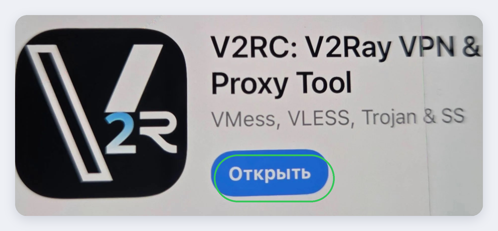
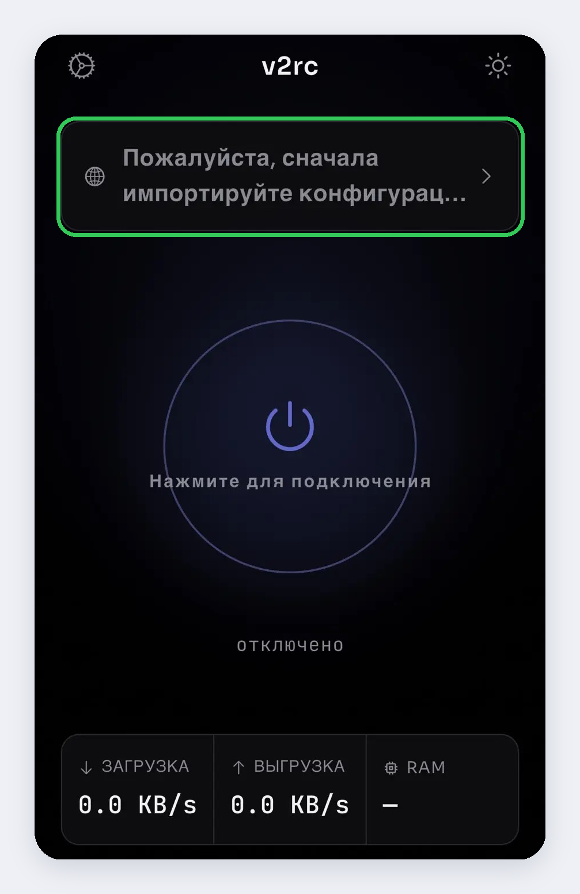
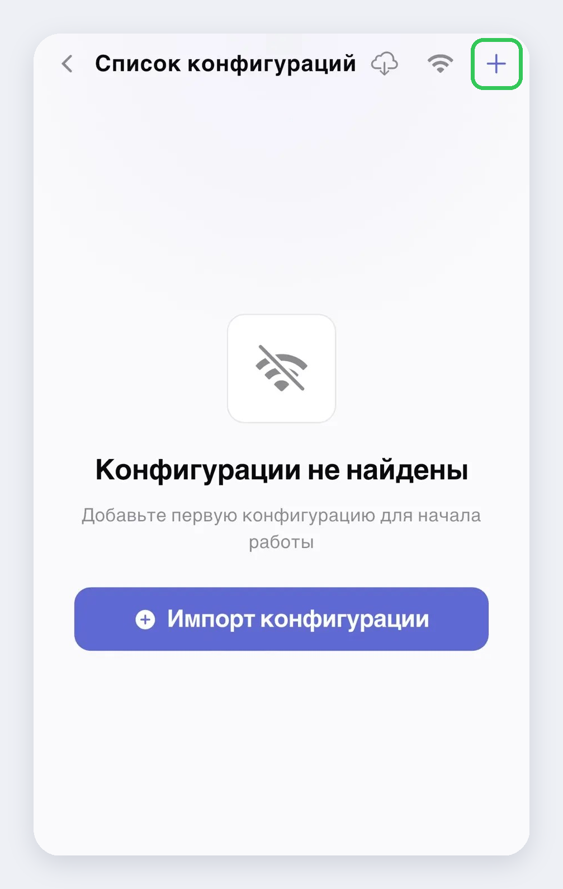
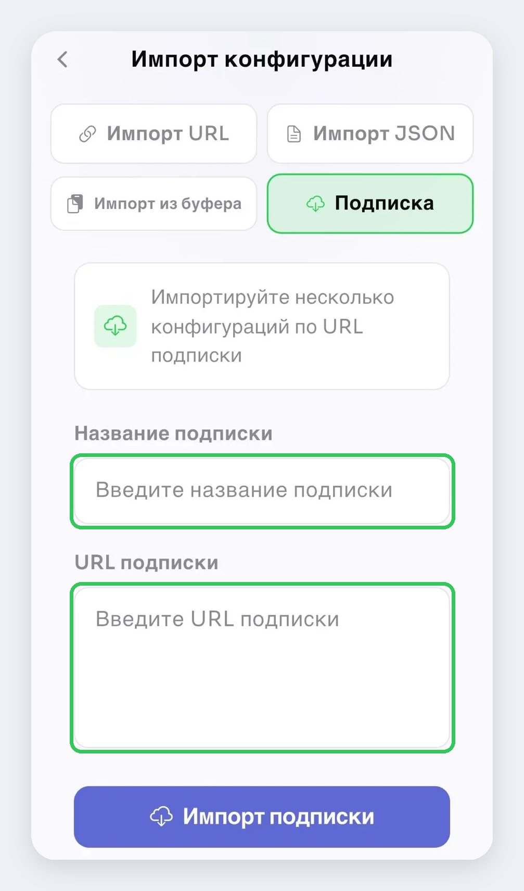
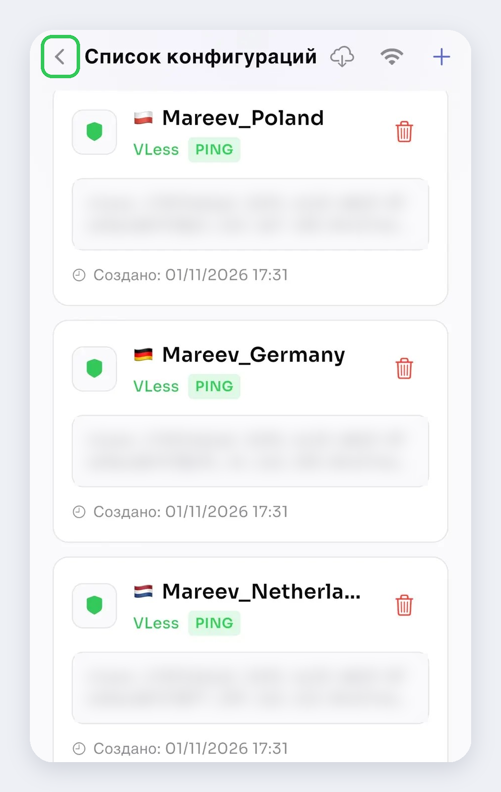
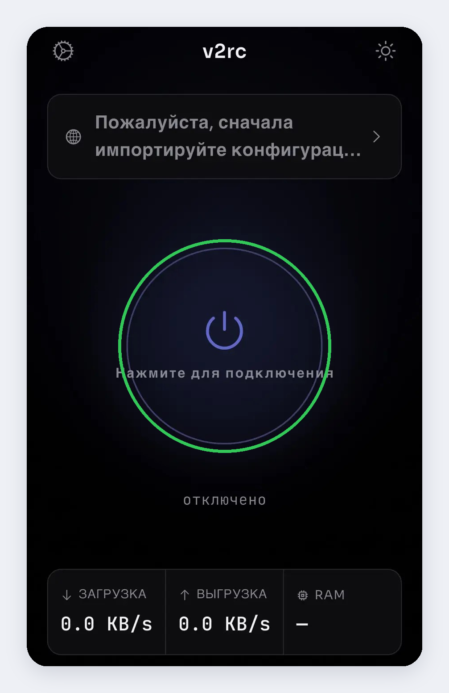

# Как подключить VPN на iPhone

**1. Установите приложение V2RC**
Найдите в App Store приложение **V2RC: V2Ray VPN & Proxy Tool** и установите его.

**2. Откройте приложение**
Нажмите на строку вверху экрана: «Пожалуйста, сначала импортируйте конфигурацию…»

**3. Добавьте конфигурацию**
Нажмите на **＋** в правом верхнем углу.

**4. Вставьте ссылку**
На вкладке **«Подписка»**:
- в поле «Название подписки» впишите любое название;
- в поле «URL подписки» вставьте ссылку от Никиты;
- нажмите **«Импорт подписки»**.

**5. Включите VPN**
Когда загрузится список серверов, нажмите стрелку **‹** в левом верхнем углу.

Затем нажмите на большую кнопку включения. Если iPhone попросит разрешить добавление VPN-конфигурации, нажмите «Разрешить».

**6. Готово!** Пользуйтесь на здоровье 🙂
